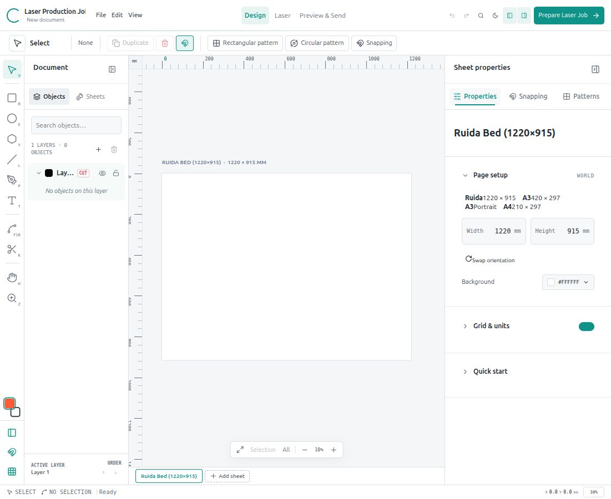

# Corelith Studio

A vector design and laser job preparation app with Bézier editing, snapping, Knife and rectangular/circular patterns. Selected curve arithmetic recovered from the supplied Corel and RDWorks binaries is integrated; this is not their original source project.



Current verified state: **109 tests passed** (99 JavaScript + 10 Python), production build passed. Installed Linux release: `2026-10-26T12-36-19-596Z`. See [current status and documentation index](docs/CURRENT_STATUS.md) and [next-session handoff](NEXT_SESSION.md).

## Run it

```bash
cd corelith-studio
npm install
npm run dev
```

Open the URL printed by Vite (defaults to `http://localhost:5178`).

## Startup and recovering work

Every launch/reload opens a blank document with one empty sheet. Previous artwork is no longer opened automatically. Use **File → Restore last autosave** to recover the last locally saved session, or **File → Open project** for exported projects. The untouched startup canvas does not overwrite the prior autosave; autosaving resumes when the document changes. The showcase is available only through **File → Restore showcase demo**.

## Desktop app (Linux)

Run `npm run desktop:install` to build and install an independent copy with Desktop and application-menu shortcuts named **Corelith Studio**. This uses installed Chrome/Chromium in a dedicated application window, a bundled Node runtime, and system Python 3 for the upload bridge. The launcher starts the local production server automatically at **http://127.0.0.1:5188**. It needs no development server or npm command for everyday use. Explicit storage uploads are enabled; the app never starts cutting or sends frame/jog/firing commands.

Installed releases live in `~/.local/share/corelith-studio/releases/`, separately from this source folder. The launcher is `~/.local/share/corelith-studio/launch.sh`; app data uses `~/.local/share/corelith-studio/browser-profile/`, and server logs use `~/.local/state/corelith-studio/server.log`. Browser autosaves and desktop autosaves are separate: export your existing project with **Ctrl+S**, then use **File → Open project** in the desktop app. Keep exported project copies as backups. Installation preserves old releases and does not delete source or project data. After updating an installed release, stop the older desktop backend before reopening so the new build is served.

```bash
npm run build     # type-check + production build
npm run preview   # serve the production build
```

## Redesigned workspaces

Use **Design → Laser → Preview & Send** in the top bar. Design keeps drawing, node editing, snapping and patterns together. Laser contains expandable layer operations and optimization. Preview & Send contains the theoretical summary/simulation, connection review and output. The top-bar Upload action opens review; it never sends by itself. Verify the connection, review the job, then use **Upload to Machine Storage** explicitly.

**Ctrl/Cmd+K** searches commands. **File → Export…** groups project backups, artwork and machine formats. The top bar reports actual local autosave success/failure. Light/dark theme, panel preferences and expandable sections persist separately from project geometry. Objects are searchable; Sheets manages existing sheet actions. On narrow screens, panels collapse and open one at a time. Use a desktop/laptop for precision production work.

Read the [redesign audit](docs/ui-redesign-audit.md) and [implementation report, screenshots and file list](docs/ui-redesign-report.md).

## Drawing and repeating artwork

For a circle, select an ellipse and click **Make circle (W = H)** under Transform. It uses the current width as diameter, preserves the centre and locks proportions; change W or H to resize the circle. Unlock aspect ratio when you want independent dimensions. An existing ellipse keeps its proportions while locked, so the lock alone does not make it circular. Number fields commit only actual edits; simply leaving a rounded field no longer changes the design.

Select an object and use the property bar for **Rectangular pattern**, **Circular pattern** or **Snapping**. Multi-object patterns preserve the selection as an assembly. Press **K** for Knife; its property bar offers path mode, Slice/Gap/Overlap and selected-only/all-under-path scope. Knife edits drawing geometry; laser operation settings remain under Laser → Layers. Press **N** to toggle snapping. See [drawing controls and verified limits](docs/RDWORKS_REVERSE_ENGINEERING.md).

## Laser / sign production workflow

The **Laser** inspector turns artwork into a machine-ready job:

- **Layer power map** — each layer can be `Cut`, `Engrave`, `Score` or `Ignore`, with independent speed (mm/s), power (%) and pass count. Operation badges appear in the layer tree.
- **Toolpath generation** — flattened geometry, kerf compensation (centre / outside / inside), optional lead-ins and lead-outs (off by default), and scanline hatching for filled engrave regions.
- **Machine sequencing** — engrave → score → cut grouping with nearest-neighbour rapid optimisation, machine-origin addressing and start-point markers.
- **Production preview** — dark material view with colour-coded toolpaths, kerf bands, lead-ins, sequence labels, ghosted source geometry, machine envelope and live path length/time estimates.
- **Sheet nesting** — shelf-packing with material margin, spacing and optional 90° rotation; placement is undoable.
- **Shop file exchange** — import `DXF` (`LINE`, `LWPOLYLINE` with bulges, `POLYLINE`, `CIRCLE`, `ARC`) and `PLT/HPGL`; export `DXF` (Y-up, named process layers), `PLT` and a `.laser-job.json` handoff package.
- **Image/PDF preparation** — preview a selected PDF page or image, set physical size and threshold, then import editable cutting outlines or vector engraving lines.
- **Preflight warnings** — skipped text objects, open cut contours, missing cut process, hatching limits and geometry outside the sheet.

Open the **Laser** workspace in the top bar or press `Shift+Ctrl/Cmd+L`. Icons in the layer tree show the active process for each layer. Import is available from **File → Import vectors / image / PDF** or from the Laser output section.

### Image and PDF import

PNG, JPEG, WebP, BMP, GIF (one frame) and PDF files open a preview before changing the drawing. Select a PDF page, width in millimeters (height stays proportional), dark threshold and optional inversion. **Filled engraving** creates horizontal vector scan lines on an Engrave layer; **Trace outlines** creates closed boundaries, including holes, on a Cut layer. Review layer speed and minimum/maximum power before exporting. Imports are local, undoable and saved as editable vector paths; the original file is not required when reopening the project. White/transparent gaps are not joined with burning lines.

PDF pages are rendered with bundled PDF.js, then monochrome traced; original PDF Bézier curves, layers and color separation are not preserved. This is not native grayscale/dither photo engraving or lossless PDF vector extraction. For precision vector parts, prefer SVG or DXF. Rendering uses at most 1024 pixels on the longest side; small details can be lost, so inspect the preview at the intended physical size. PDF page dimensions are used for the initial size, reduced to fit the active sheet when necessary. Images initially use 96 DPI sizing, reduced to fit; embedded print-DPI metadata is not applied. You can enter the intended width explicitly. Limits: 50 MiB files, 40 megapixel source images, 1000 PDF pages, 10,000 trace paths, 80,000 retained nodes. Password-protected PDFs must be unlocked before import.

See [the image/PDF import guide](docs/IMAGE_PDF_IMPORT.md) for steps, engraving spacing, mode differences, limits and troubleshooting. Import one PDF page at a time. Reimport to change tracing settings after accepting an import; the project stores the resulting paths, not an editable source bitmap.

After a storage upload, the cutter LCD may continue showing the current design or a cached file list. **Esc → File → select the uploaded filename** reloads the list/preview on this controller. Corelith reports the stored filename and readback status, and never auto-starts or remotely changes the panel selection. No verified refresh-only command has been established for this firmware.

The **Estimated job time** card includes every pass, lead and laser-off travel. Expand **Time breakdown & allowance** for operation and layer durations and an optional 0–300% planning allowance. This allowance is saved with the project and included in the JSON handoff, but never changes machine speed, power, RD bytes or the simulation timeline. The baseline uses path length / configured speed; acceleration, cornering and controller delays are not modelled. Travel assumes the preview start point, so actual head position can also affect elapsed time. Calibrate the allowance against measured jobs on your machine.

Set each layer's operation, speed, minimum/maximum power, passes and air assist under **Laser → Operations**. Jobs run engrave → score → cut. With **Inside-to-Outside** enabled (the default), nested closed cut contours run before their containing outlines; this also applies when rapid optimisation is off. Engraving currently uses vector hatching, rather than native photo/raster engraving.

**Text:** select text and use **Design → Typography → Convert selected text to curves**, or use **Convert job text to curves** beside the laser preflight error. Conversion is undoable, retains object/layer identity, and includes real glyph contours and holes. Canvas text and conversion use bundled Liberation Sans/Serif/Mono (Regular or Bold); the legacy family choices resolve to these compatible families. Unsupported glyphs and scripts needing complex shaping fail with an explanation; import outlined SVG for those scripts. Text is never silently omitted from an uploaded job. [OpenType parser documentation](https://github.com/opentypejs/opentype.js/) and font licensing are included in `public/fonts/LICENSE.txt`.

**Text infill:** select editable or previously converted text and enable **Design → Text infill → Filled text engraving**. Choose the hatch spacing (0.02–5 mm), then convert editable text to curves before sending. Enabled text is filled with vector hatch engraving before cuts, including when its layer's default operation is Cut or global Scan Hatch Fills is off. It retains the layer's speed, minimum/maximum power, passes and air assist. Put text on a separate layer to give it independent engraving parameters. Letter counters remain open. Other objects keep their layer operation; ignored/hidden layers remain excluded. Disable infill to return to ordinary layer processing. Time estimates and simulation include the hatch paths; existing hatch complexity limits still apply.

**Power controls:** both sidebars show the same effective maximum. Reducing maximum power also reduces a stale higher minimum; it never raises the maximum to match a minimum. Minimum edits are bounded by the maximum. Older projects missing explicit power bounds derive them from saved power, instead of an unrelated default. Explicitly invalid saved bounds still block export with the layer name and both values: use **Review layer minimum / maximum power**, then correct the values or click **Reduce minimum**. Origin/placement guidance is informational and independent of power validation.

Power fields commit on Enter or blur, so intermediate digits cannot alter linked minimum power. Changing a layer to Score/Cut/Engrave preserves entered process settings; material presets remain an explicit way to replace them. To match a working RDWorks score, compare speed, minimum power, maximum power, passes and air assist. Score uses vector cut motion. See [the RDWorks comparison](docs/RDWORKS_COMPARISON.md) and the read-only `scripts/inspect-rd-settings.mjs` tool.

**Contour entry:** **Laser → Optimization → Entry, exit & overcut → Contour only** is the default, including for older projects with saved lead lengths. Burning starts on the design; initial travel remains laser-off. Optional **Outer outlines only** enables configured leads on outer contours while keeping internal cuts free of leads. **All closed contours** explicitly enables them on internal contours too. Rapid optimization chooses nearby existing starting vertices without changing contour winding or dimensions. Regenerate previously exported/uploaded RD files to apply these changes.

**Layer colours:** click the colour swatch beside a layer in Artwork for a custom colour, or select a standard palette colour in **Laser → Operations**. Choosing a colour recolours the layer's existing objects (outline, fill colour and gradient stops), without enabling absent fills/outlines. Newly added/imported objects and objects transferred into that layer inherit it. Other layers retain their colours. Laser paths and RD layer metadata use the layer colour. Undo restores the previous colours. Pattern copies retain the source appearance; changing the layer colour later recolours them along with the other layer objects.

**Workflow:** Design → Laser → Preview & Send keeps editing, preparation and transfer review in one document. Preview shows the estimated time and a complete selectable execution list with paged expansion. Solid paths show burning; dashed paths show travel. Selected toolpaths remain bright while other paths are dimmed. Selected hollow shapes/groups can be dragged from their empty interior; Shift adds/removes selection and blank space starts a marquee.

## Laser preparation and sending

For the complete local laser workflow, run:

```bash
npm run laser       # app + explicit storage uploads at http://127.0.0.1:5178
npm test            # offline tests; no cutter access
npm run build       # TypeScript + production bundle
npm run laser:preview # serve that build + bridge at http://127.0.0.1:5179
```

`npm run dev` and `npm run preview` provide the same bridge in read-only mode. Stop an existing server before launching another on the same port. The app never starts a job or sends frame/jog/firing commands. Upload requires clicking **Send to Laser Storage**.

The saved EVA II 43 profile is **192.168.1.11 / UDP 50201**, confirmed by the working GEN100.RD transfer. In **Preview & Send → Connection**, Verify sends the UDP handshake. Connection settings persist; the reset button restores the verified profile. Review the visible job preflight, dimensions, material parameters and final eight-character filename, then send. Progress counts acknowledged bytes; read-only FTP readback verifies stored bytes and shows the controller file index when available. Interrupted status reads never automatically resend file data.

Use `.rd` for the controller and `.dxf` to exchange supported geometry with RDWorks. Native `.rld` export is unavailable; older Corelith-generated `.rld` files were not native RDWorks documents. RD import recovers vector motion for inspection and warns that orientation/process settings must be reviewed.

Simulation and RD/DXF/PLT export share lead geometry and pass counts. Vector-file imports preserve physical dimensions and warn about oversized artwork; image/PDF imports offer an explicit size preview with an initial fit to the sheet. Sheets own separate artwork; SVG supports units/viewBox, transformed curves and compound fills. Incomplete or unsupported jobs show errors instead of silently exporting a partial job.

See [the app audit and full workflow](docs/APP_AUDIT.md) for repaired faults, verification and remaining scope, and [the protocol evidence](docs/RUIDA_PROTOCOL_SPECIFICATION.md) for the original RD file repair. The earlier hardware-verified sample remains unchanged in `corrected/`. Follow-up repairs were verified offline and in the browser; no additional file was sent to the cutter during the audit.

The offline CLI uses the same RD encoder and requires physical width:

```bash
node scripts/convert_svg.mjs ../genetic-data-svgrepo-com.svg output --width-mm 100 --speed 30 --power 50 --min-power 30
```

It accepts untransformed M/L/H/V/C/S/Z paths, rectangles and circles and writes RD plus DXF. Use the browser importer for the broader SVG subset. Example speed/power values are not a material calibration.

## What is implemented

### Vector drawing pipeline
- Double-precision millimetre world coordinates with a 3×3 viewport transform, pan and cursor-anchored zoom from ~4% to 5000%.
- Page/artboard model with layers, z-order, visibility and locking.
- Paper, grid, rulers, page shadow, guides, object rendering, selection gizmo, node overlay, snap overlay and ruler overlay passes.
- Solid, linear-gradient, radial-gradient, four-corner mesh-gradient and procedural pattern fills; non-zero and even-odd fill rules.
- Configurable stroke width, opacity, line caps, line joins, dashes and hairline-style fixed outlines.
- Drop shadows, object opacity and **PowerClip**-style live clipping (`clip` geometry / extract).
- Rulers are live: drag from the top or left ruler to create a guide, drag a guide back to a ruler to delete it.
- Export to **PNG (300 DPI)**, **SVG**, and lossless `.corelith.json`; opening a project is available from **File → Open project**.

### F10 node editing
- Anchor squares, dashed tangent arms, hollow handle nodes, distinct open-path start/end markers.
- Three node types with enforced constraints:
  - **Cusp** — independent tangent angle and length.
  - **Smooth** — locked 180° tangent, independent lengths.
  - **Symmetric** — mirrored tangent angle and length.
- Drag anchors, drag handles, or drag a whole segment (the segment shaper adjusts both adjacent handles).
- Double-click a segment to split it and insert a node at the actual Bézier parameter (midpoint is exact).
- Node inspector with numeric X/Y, tangent lengths, node-type switching and deletion.
- Automatic handle creation when converting a corner to smooth/symmetric.

### Centres & midpoints
- Bounding-box centre and true area centroid (`pathCentroid`) for irregular closed polygons and curves.
- `⊕` centre glyph on selections and hover.
- Line and Bézier edge midpoints (`B(0.5)` closed-form).
- Hover midpoint indicator + double-click segment split.
- Numeric centre/centroid readouts in the inspector.

### Snapping engine
- Screen-space gravity radius (4–22 px, default 8 px), zoom-independent.
- Grid, nodes, midpoints, centres, centroids, intersections, quadrants, guides, perpendicular projections and tangent candidates.
- Dynamic alignment rays to object edges and centres.
- High-contrast ScreenTips (`node`, `midpoint`, `center`, `intersection`, `quadrant`, `perpendicular`, `tangent`, `grid`, `guide`).
- Guide editing, grid spacing/subdivisions and a live snapping inspector.
- Snapping works while moving objects, drawing, resizing and dragging nodes/handles.

### Knife / cut engine
- **2-point** accepts click–click or drag; **freehand** cuts on release; **Bézier (smoothed spline)** uses points followed by Cut or Enter. Esc cancels.
- Curve/polyline intersection, boundary-chain extraction, topology rebuilding.
- **Auto-close** produces watertight closed halves; disabled mode yields open contour chains.
- **Gap** mode offsets the closure by ±W/2 (physical channel); **Overlap** extends both halves for seam-free vinyl/sign work.
- Preserves fill, outline, opacity, shadow and layer.
- Cut all objects under the path or only the current selection.
- Works with open contours too. Closed contours need two boundary crossings. Compound paths and more than two crossings are rejected without modifying the originals.
- Small cuts use a two-screen-pixel gesture threshold, and curved hits are refined against the actual Bézier curve. See [usage, fixes and verification](docs/KNIFE_PATTERN_UPLOAD_FIXES.md).

### Patterns
- **Rectangular / step-and-repeat**: columns, rows, offset vs. gap spacing, independent +X/−X/+Y/−Y directions, schematic grid preview and formula.
- **Circular / radial**: new-copy count, pivot, radius (0 = automatic), angle offset, signed angular span, Rotate/Upright orientation, actual geometry preview and step/radius readouts. Preview warns about off-sheet copies.
- Full-circle spacing includes the original only if it occupies the unshifted source position on the ring. Otherwise new copies fill the ring. Apply keeps the original selection; a fresh source gets a nearby pivot. Positive spans run clockwise, negative spans counterclockwise.
- Copies inherit style and are added to the source layer; the source remains intact.
- `Ctrl/Cmd+Shift+D` opens the pattern engine.
- `Shift+Ctrl/Cmd+L` opens the laser job preview.

### UX
- Tool rail with V/F10/P/K/R/E/Y/L/T/H shortcuts, contextual options bar, layer tree, inspector, status bar, toasts, undo/redo, autosave.
- Arrow-key nudging, marquee selection, shift-constrained drawing, resize handles, rotation handle (±15° with Shift).
- Keyboard shortcut sheet under **File → Keyboard shortcuts** (or `?`), command search with Ctrl/Cmd+K, and **File → About Corelith**.

## Architecture

```
src/
  core/
    geometry.ts    Bézier kernel, flattening, intersections, area centroid, offsets
    production.ts  kerf toolpaths, lead-ins, hatching, ordering, nesting, estimates
    vectorIO.ts    DXF / HPGL parsing and DXF / PLT / job export
    mediaImport.ts local image decoding and selected PDF page rendering
    bitmapTrace.ts monochrome outline tracing and vector engraving spans
    model.ts       document/page/layer/shape styles + showcase composition
    store.ts       central editor state, undo/redo, node and selection operations
    snapping.ts    candidate generation, gravity arbiter, dynamic alignment
    knife.ts       knife intersection/topology/closure engine
    patterns.ts    Cartesian and polar transform engines
    exporters.ts   PNG, SVG and project serialisation
  render/
    renderer.ts    canvas scene passes, overlays, rulers, screen tips
  components/
    CanvasStage    pointer/keyboard interaction state machine
    MediaImportModal image/PDF preview, size, threshold and engraving controls
    panels/        Design, Snapping, Patterns inspectors
```

World geometry is stored in millimetres. The viewport transform is applied only at render time, which keeps snapping, cutting and pattern math independent of device pixels. Node handles are absolute control points; node type constraints are enforced on every handle mutation.

## Deliberate scope

The project is a self-contained prototype, not a CorelDRAW binary port or machine driver. Sheets have independent artwork and editable polygon Boolean operations; native RDWorks document serialization and native raster scanning are not included. Mesh fills are a four-corner bilinear approximation rather than a full editable subdivision mesh. Use the built-in text-to-curves action before machining supported text; DXF SPLINE/blocks and HPGL arc commands are not imported yet. Engrave hatching is a scanline approximation that respects compound fill rules; its generation budget is enforced by preflight. The goal is faithful, inspectable interactive geometry for the systems explicitly covered by the architecture report.

Everything runs locally in the browser. Projects/autosaves are stored in `localStorage` and can be exported as JSON.

## Documentation and latest verification

As of 26 October 2026, the last implementation checks passed **90 JavaScript + 10 Python tests** and the production build. The installed desktop release is `2026-10-26T11-46-04-978Z`; drawing controls were browser checked and the updated desktop launcher passed its readiness check. Image/PDF rendering was also checked in the preceding production release. These checks do not establish physical cutting accuracy or automatic LCD refresh.

- [UI redesign report](docs/ui-redesign-report.md): implementation, milestone checks, screenshots and changed files.
- [Native curve analysis and drawing tools](docs/RDWORKS_REVERSE_ENGINEERING.md): recovered routines, curve-quality measurements, Knife, snapping and patterns.
- [Image/PDF import guide](docs/IMAGE_PDF_IMPORT.md): usage, tracing limits and troubleshooting.
- [App audit](docs/APP_AUDIT.md): repaired faults, workflow and verification history.
- [RDWorks comparison](docs/RDWORKS_COMPARISON.md): path and scoring evidence.
- [Ruida protocol evidence](docs/RUIDA_PROTOCOL_SPECIFICATION.md): transport, storage and LCD limitations.
- [Next-session handoff](NEXT_SESSION.md): current state, installed release and remaining work.
