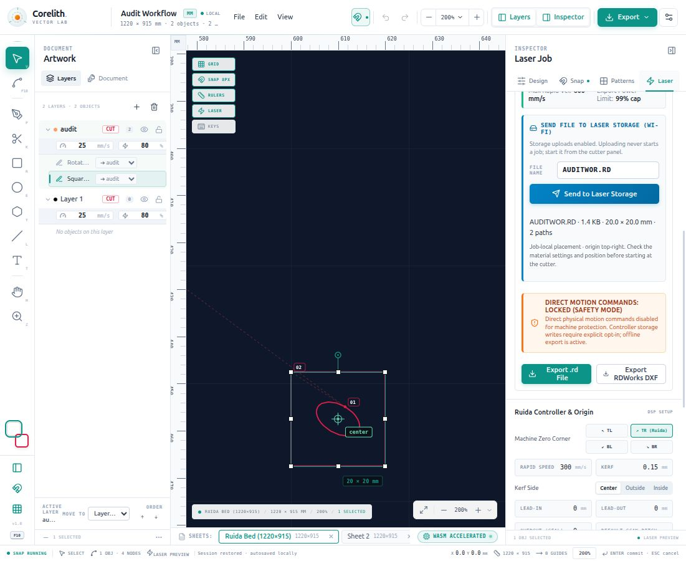

# Corelith Studio audit and repairs — 24 October 2026

## Follow-up — 26 October 2026

Latest implementation verification: **99 JavaScript + 10 Python tests passed**, production build passed. Counts in earlier entries below describe those earlier checkpoints.

Current installed release: `2026-10-26T12-36-19-596Z`, served bundle `index-shWk_QUb.js`, port 5188. Startup opens a blank sheet; **File → Restore last autosave** explicitly recovers the previous local session. The untouched blank startup is not autosaved over previous work. See [current status](CURRENT_STATUS.md) for present behavior and limitations.

## Historical implementation checkpoints

UI redesign: implemented three workspaces, searchable Objects/Sheets, contextual progressive inspector, light/dark themes, truthful autosave, command search, aspect-lock/fitting and grouped export dialogs. Laser operations are expandable; optimization/nesting, preview/validation and connection review are separated. Readback mismatch and unavailable verification have distinct outcomes. **100 tests and production build pass**. Installed release `2026-10-26T11-46-04-978Z` passed launcher readiness and serves the tested bundle. Source/project compatibility, prior releases and original Audit Workflow are preserved; no cutter access occurred. See [redesign audit](ui-redesign-audit.md) and [full report/screenshots/changed files](ui-redesign-report.md).

Corel drawing/curve-quality follow-up: mounted the missing property bar, exposed Knife and pattern controls, simplified snapping and advanced effects, repaired phantom closing-edge intersections, tangent detection, hidden/locked alignment guides, Knife corner handling and shared multi-object pattern transforms. Actual selected native curve arithmetic was decompiled with REA/Ghidra and integrated; adaptive machining curves and curved DXF imports reduce polygon artifacts. Quantization-safe relative burn moves match the native command style. Independent 25 mm circle deviation improved from 0.063060 mm to 0.003894 mm. **88 tests and build pass**; browser verified patterns, actual Knife split and undo restoration. Installed release `2026-10-26T11-03-08-910Z` preserves previous releases; the verified idle backend was restarted and launcher readiness passed. No cutter access or physical comparison cut occurred. See [evidence, metrics and limits](RDWORKS_REVERSE_ENGINEERING.md).

Image/PDF import now provides local PNG/JPEG/WebP/BMP/GIF decoding and selected-page PDF rendering, with size, threshold, inversion, outline cutting and filled vector engraving. Imports preserve holes, islands and transparent gaps, create editable paths on the chosen Cut/Engrave operation, and undo as one action. PDF.js resources are bundled offline, and desktop `.mjs` MIME handling was repaired. PDF artwork is rendered then traced at a maximum 1024-pixel side; lossless PDF vectors and grayscale/native raster engraving remain unsupported. See [the import guide](IMAGE_PDF_IMPORT.md). Browser checks covered PNG modes, PDF pages, import/export readiness and undo; the installed production build also rendered both PDF pages. Desktop release `2026-10-26T09-26-44-613Z` was installed, its verified idle previous backend was restarted, and launcher `--check` passed. Original artwork and prior releases were preserved.

LCD follow-up: the operator reports new files appear after pressing Esc and reopening File. Uploading to storage does not explicitly select the new panel job. Persistent guidance and filename-specific success messages now explain **Esc → File → select the uploaded filename**. A verified refresh-only command for this firmware has not been established; **automatic LCD refresh is unresolved**. No remote panel keys, file selection, job start, index edits or additional upload were used for this investigation.

Independent burn verification also checks that the native RDWorks square and Corelith square cover only their intended perimeter. Nested outer/inner cuts plus a separate score line have exact intended burn coverage at all four origins and repeated passes, with laser-off positioning between contours. This is decoded-command evidence, not a new physical comparison cut. See [the RDWorks report](RDWORKS_COMPARISON.md#independent-burn-only-geometry-verification).

RDWorks/score follow-up: compared the manufacturer's manual and native controller files, including user-supplied reference PRL.RD retrieved read-only. KEYCHAIN.RD has **200 mm/s, ~1% minimum, ~12% maximum** in header and runtime records. PRL has 100 mm/s at ~20% min/max and 15 mm/s at ~70% min/max; the exact RDWorks 200/12 file is missing. Fixed settings reset on operation change, intermediate typed digits changing linked minimum power, and omitted explicit air-OFF. Added an independent RD settings inspector and native-file regressions. Path generation now defaults to contour-only without leads, optionally limits leads to outer contours, and chooses nearby existing vertices for closed-contour starts without changing the design. **61 tests and build pass**; browser confirmed typing/mode preservation and contour-only controls. Original artwork restored after temporary tests. All machine access was FTP retrieval only: no storage writes, parameter changes, motion or job start. See `RDWORKS_COMPARISON.md`, `controller-score-readback.json` and `score-settings-preserved.png`.

Power validation/text infill: lowering only maximum power previously left a hidden higher minimum. Power updates now synchronize maximum with the sidebar power field and lower stale minimums, while invalid imported bounds remain explicit layer-specific preflight errors with a repair control. Normalization of legacy missing bounds respects saved power. Added per-text hatch infill, persisted through curve conversion and undo, with explicit spacing, preserved counters, engrave-first order and unchanged layer speed/power/passes. Other artwork retains its operation, and layer time breakdowns identify mixed operations. **55 tests and build pass**, including power editing/migration, invalid-bound diagnostics, O-counter preservation, ordering and RD generation. Browser confirmed power editing and filled-text readiness. No machine commands or uploads were sent.

Drawing/alignment repair: draft geometry was drawn in world coordinates on the screen-space overlay, without zoom/pan, so it appeared offset during drawing. Applied the same transform used for finished artwork, reset the path before each draft, and kept dashed strokes at screen size. Alignment calculations were correct; icons for the vertical alignment row depicted horizontal actions. Replaced the icons, added explicit axis descriptions, and made the single-object page target visible. Tests cover all four draft primitives at multiple zoom/pan values and both alignment axes with page/selection targets and undo. Browser checked real drag coordinates and independent X/Y movement. **52 tests and build pass**. Original artwork and snap preference restored after checks; no cutter interaction.

Additional text-visibility repair: the renderer previously called only `fillText`, while newly created text uses `fill: none` with a visible outline. It now honours both fill and outline settings; Laser preview shows readable unconverted source text, and the Typography editor has explicit foreground/background/caret colours and an accessible label. Added a regression check for outline-only, fill-only and intentionally unpainted text. **50 tests pass** with the build; both canvas modes and editor were visually checked. Updated desktop release includes this fix. No cutter action was taken.

Fixed dragging selected hollow artwork from its empty interior and added explicit, undoable text outline conversion so text is included in a valid job rather than skipped. Bundled fonts make conversion available offline; unsupported glyphs and complex shaping remain explicit errors. Regression checks cover closed glyph counters, multiline alignment/spacing, rotation, machinable output, ignored layers and undo.

Added undoable custom layer colours and a matching standard palette action. Existing objects recolour; new/imported, duplicated, pasted, patterned and transferred objects inherit chosen layer colours. Fill/outline enablement and other layers are preserved. Production previews and exported RD layer metadata use the layer colour.

Started the roadmap with sticky workflow navigation and readiness/time, per-layer selection/time, selected-path emphasis, and a full execution list with progressive expansion. Rapid preview lines now include lead endpoints and repeated passes. The stronger layer table and advanced manufacturing features remain future scope in `NEXT_SESSION.md`.

Packaged a separate Linux desktop copy under `~/.local/share/corelith-studio/releases/`, with bundled Node, local production/UDP bridge, and an installed Chrome/Chromium application window. Desktop and application-menu shortcuts are named **Corelith Studio**. Browser and desktop profiles have separate autosaves; use exported projects to transfer artwork. Source was preserved and backed up to `backups/corelith-source-before-2026-10-26.tar.gz` before editing. The drawing used for browser checks was exported to `backups/audit-workflow-before-ui-checks.corelith.json` and restored after temporary checks.

Verification: **39 JavaScript + 10 Python tests pass**, production build passes, browser checks confirm actual dragging, blocked-to-ready text conversion, colour matching, sequence display and enabled Send control. The installed production app loads without console errors. All transfer tests remain offline mocks; no machine probe, storage upload, motion or firing command was sent during this follow-up. See `workflow-2026-10-26.png` for the test-design UI.

The existing GEN100.RD upload on UDP 50201 was acknowledged, read back byte-for-byte, and reported working by the operator. This follow-up audited the app and repaired the additional faults below. No new file, motion, frame, start, parameter or laser-firing command was sent to the cutter during this follow-up. Network transport and storage checks in the automated suite use mocks.

## How to use the repaired workflow

From `corelith-studio`:

```bash
npm run laser
```

Open **http://127.0.0.1:5178**. This runs the local app with explicit storage uploads enabled. `npm run dev` runs the same app with uploads disabled. To serve a production build with uploads enabled, use `npm run build` followed by `npm run laser:preview`, then open **http://127.0.0.1:5179**. Both servers bind only to localhost and report a port conflict rather than silently moving to a different URL.

1. Open or import the intended artwork on the correct sheet. Vector-file imports preserve physical dimensions and report oversized geometry. Image/PDF imports show a size/trace preview and initially reduce oversized pages/images to fit; verify the intended millimeter dimensions before accepting.
2. Open **Laser → Layers**, choose Cut / Score / vector-hatch Engrave, and set speed, minimum/maximum power, blower and passes for the material. The listed material presets are examples, not machine/material calibrations.
3. Preview and simulate. Lead geometry, repeated passes and rapid travel are included in the preview timeline, bounds and time estimates. Estimates still omit acceleration and controller overhead.
4. In **Laser → Machine**, use **192.168.1.11, UDP 50201**. **Use verified EVA connection** restores those values. Valid connection settings persist across panel changes and reloads. **Verify** explicitly sends only the non-motion UDP handshake; verification does not upload or run a job.
5. Check the preflight and final eight-character filename. **Send to Laser Storage** sends that prepared RD file once. Progress advances only for acknowledged data. A new transfer cannot overlap another transfer/probe. The app remains inspectable while the bridge transfers the prepared snapshot.
6. The bridge reads back the exact stored file using FTP RETR and reports a matching file/index, unavailable verification, or a mismatch. It never edits FTP files or indexes. Acknowledgement and verified storage are distinct outcomes. If the LCD retains its current design or an old file list, press **Esc → File**, then select the uploaded filename to load its preview. Automatic LCD refresh is not implemented. Operate the physical machine from its panel; the app has no start/frame/jog/firing endpoints.

A missing ACK aborts immediately, without retransmitting an ambiguous chunk or trying another port. Changing panel tabs/reloading resumes status reads, not a new upload. If the POST response is lost, the original request ID can recover its transfer status without retransmitting the file. After repeated status-read failures, upload remains blocked until the original transfer is resolved or the operator explicitly clears it after checking the cutter. Restarting the bridge loses its in-memory transfer ledger; the UI reports an uncertain outcome instead of assuming failure means no file was stored.

## Confirmed faults repaired

| Area | Fault found | Repair / check |
| --- | --- | --- |
| Connection | TCP was used to assess the working UDP interface | Real UDP CC handshake, port 50201 default in app/bridge/Python; explicit Verify action |
| Upload controls | Required hidden launch setting, lost connection fields, no progress | Dedicated laser launch commands, persistent/editable profile, visible bridge mode, acknowledged-byte progress |
| Upload concurrency | Multiple requests could contend for source port 40200 | One active probe/transfer, atomic busy check, request IDs bound to a job fingerprint |
| Interrupted upload UI | Browser/panel loss could obscure an ongoing transfer | Bridge transfer ledger, polling, session recovery, safe request-ID lookup; no automatic resend |
| Upload integrity | ACK did not prove the stored file matched | Optional CLI / automatic UI read-only FTP byte comparison and index lookup; distinct mismatch/unavailable results |
| Production preview | Leads omitted from bounds and rapid distance | Shared ordered burn vertices and corrected bounds/travel estimates |
| Simulation | Animation reused its initial progress; state snapshots did not change | Accumulated progress and new store snapshots; browser playback reaches 100% |
| Simulation trajectory | Passes, leads, blower settings and speed-weighted timing omitted | Same burn geometry as export, repeated passes, actual process values, duration-based timeline and cached lookup |
| Engraving | Compound holes were filled separately; layer scan interval ignored | Compound scanline fill obeying even-odd/nonzero rules and layer pitch |
| Incomplete jobs | Text/clipped geometry and hatch truncation could produce partial machine files | Visible preflight errors block RD/DXF/PLT export; original source artwork remains editable |
| Process ordering | Inside-out sequencing disappeared when rapid optimization was disabled | Operation grouping and inner-contour ordering work independently of nearest-neighbor optimization |
| Import dimensions | Large imported jobs silently shrank to fit the page | Preserve size, center when possible, warn when the sheet is too small |
| SVG import | Units/viewBox, inherited attributes, ellipse handles and several curve commands were wrong/missing | Millimeter viewport transform; transformed control points; M/L/H/V/C/S/Q/T/A/Z support; rounded rectangles and ellipses |
| SVG import completeness | Definitions could be imported as artwork; unsupported text/symbols/clipping/CSS could disappear | Skip nonrendered definitions; reject unsupported references/styles/clipping with actionable errors |
| SVG export | Stroke colour was never written | Explicit stroke attribute; tested stroke-only shapes remain visible |
| PLT import | First pen-down segment was lost; PA/PR coordinates ignored | Preserve the preceding pen-up position and process all coordinate commands |
| DXF/PLT export | Lead-out geometry and repeated passes omitted | Both use the shared ordered toolpath vertices, including leads and passes |
| DXF arcs | Fixed coarse angular steps gave large errors at large radii | Chord subdivision targets 0.05 mm sagitta for arcs and polyline bulges |
| Sheets | Tabs shared the same artwork list | Independent sheet artwork/active layer; switching, deletion, undo and JSON round-trip tested |
| Sheet UI | Canvas covered the sheet bar and intercepted its clicks | Reserved a visible strip with correct stacking and canvas bounds; browser-tested switching |
| Project loading | Partial old settings could crash; failed opens could alter history | Clone/validate/migrate projects, merge defaults, validate geometry, preserve source input |
| Session restoration | Autosaves older than 45 days were silently discarded | Retain valid autosaves regardless of age |
| Editing | Layer-process changes lacked undo; stale selections could delete locked shapes | Process changes record history; locked/hidden shapes excluded from editable selection |
| Numeric fields | Clearing fields became zero; exponents were stripped; Enter committed twice | Finite numeric parsing, visible normalized value, one blur commit, correct stepping from zero |
| Boolean geometry | Traversal could return the wrong boundary or the original polygon on failure | Split-edge boundary classification, compound holes and shared-edge handling; 324 rectangle-area checks plus compound cases |
| Knife geometry | Closed-path boundary wrap was clamped to the last segment | Wrapped segment traversal, area conservation test; reject unsupported complex cuts while preserving originals |
| PowerClip | Extraction removed unrelated clips and recorded history after mutation | Affect only selected contents/frames; snapshot before mutation; undo and duplicate offset tested |
| Radial copies | Start angle omitted from rotated shape orientation; copied clipping geometry stayed behind | Include start angle and transform copied clipping geometry |
| Nesting | An oversized rejected item consumed a usable shelf | Commit a row move only if a placement fits |
| Large PNG export | Full machine bed at 300 DPI could allocate over 600 MB | Explicit pixel/side limits and a visible export error; never silently reduce requested resolution |
| Status wording | Invalid jobs could still display JOB READY, times double-counted rapid, generic A3 badge | Preflight-aware status, “includes rapid” estimate label, actual document unit badge |

Arc implementation reference: [W3C SVG implementation notes](https://www.w3.org/TR/SVG/implnote.html). Existing RD protocol evidence is recorded in [RUIDA_PROTOCOL_SPECIFICATION.md](RUIDA_PROTOCOL_SPECIFICATION.md).

## Original audit verification — 24 October 2026

- `npm test`: 32 JavaScript tests plus 10 Python tests at completion. Includes native RD fixture comparisons, independent coordinate decoding, production/simulation invariants, process settings, SVG geometry/units/strokes, PLT import, independent sheets, Boolean area algebra, knife area preservation, clipping undo, nesting and mocked network/FTP behavior.
- `npm run build`: TypeScript and the Vite production bundle passed.
- Browser: new machine-bed document; import `tests/fixtures/audit.svg` (20 mm square and rotated ellipse, with unused definitions); verify exactly two objects and 20 × 20 mm artwork bounds; persist/reset connection settings; create/switch sheets; run simulation to completion; export `AUDITWOR.RD` through the actual download control.
- Independent read of the downloaded browser RD: embedded name `AUDITWOR.RD`, 1,433 bytes, frame bounds exactly **20 × 20 mm**, valid final EOF. The test download was not uploaded.
- Controller: the earlier working `corrected/GEN100.rd` is preserved unchanged. New geometry/editor/transfer-recovery changes were not physically exercised on the machine in this follow-up.

The app is left running locally in laser mode at http://127.0.0.1:5178, showing the explicitly named **Audit Workflow** test document. No upload was initiated from that document.



## Remaining scope and limitations

This is a broad repair/audit of a prototype, not a guarantee that every possible drawing or controller firmware is covered.

- Native RDWorks RLD serialization remains unavailable. Use DXF from RDWorks/Corelith; native RLD import is still heuristic and should be checked against the source. RD import recovers controller-coordinate geometry, not original process settings or document orientation.
- Timed dots, pen mode, micro-links, nonzero overcut and repeatCount > 1 remain unsupported in RD export and are blocked. Use Passes for repeated contours. Engraving is vector hatching, not a native raster scanner.
- Image/PDF import is monochrome tracing with a 1024-pixel maximum side. PDF vectors/layers/text are not preserved; grayscale/dither image engraving and editable bitmap placement remain future work. See [the import guide](IMAGE_PDF_IMPORT.md) for all limits.
- Automatic LCD file-list refresh remains unresolved; stored-file verification does not establish that the open panel menu refreshed.
- Convert SVG CSS classes, referenced symbols, nested SVG, text, images, masks and clipping to ordinary paths/presentation attributes. Unsupported DXF entities still report import warnings; inspect such imports against the source or re-export supported line/arc/polyline geometry. Unsupported PLT arc commands fail explicitly.
- Boolean operations flatten curves at 0.08 mm and cap complexity; near-degenerate/self-intersecting geometry still requires inspection. Knife cutting supports simple contours with at most two crossings of a closed contour; compound/multiple-crossing cuts fail explicitly instead of damaging geometry.
- Kerf remains a polygon offset approximation. Very narrow, self-intersecting and intricate contours need visual inspection after compensation.
- Sheet geometry/active layers are independent; job-wide production options such as origin, hatch defaults, kerf and leads are shared. Older projects with multiple page tabs but one artwork list migrate that artwork onto the active sheet; formerly empty/shared tabs become independent empty sheets.
- PNG export is limited to 64 megapixels / 16,384 pixels per side. SVG is available for large sheets. Decorative gradient/mesh/pattern effects do not become laser power modulation.
- The transfer ledger is local and in memory, and the saved machine profile is specific to this EVA controller. If another controller does not provide FTP readback, the UI reports the upload as acknowledged with verification unavailable. It does not claim byte-verified storage.

## Knife, circular patterns and upload follow-up — 26 October 2026

Repaired 2-point Knife gestures and short drags, refined curve crossings, corrected custom-radius full-ring spacing, replaced decorative circular preview with actual geometry and prevented repeated Apply selection multiplication. Native RDWorks transfer evidence supports the existing uploader; no protocol changes or cutter access. **96 JavaScript + 10 Python tests pass**, production build passes. See [details and evidence](KNIFE_PATTERN_UPLOAD_FIXES.md).

## Clean startup — 26 October 2026

Removed automatic showcase/autosave opening. Startup now uses one empty sheet with no selection or draft. Untouched startup does not overwrite the prior autosave; File → Restore last autosave loads it explicitly and can be undone. Autosaving resumes on document changes. Browser checked recovery of the two-object Audit Workflow and a subsequent blank reload. **97 JavaScript + 10 Python tests passed**, production build passed. Installed release and served bundle are listed at the top. Screenshot: [clean startup](clean-startup.png). No cutter access.

## Circle sizing — 26 October 2026

Fixed numeric-field blur applying rounded display values despite no edit. Added explicit Make circle for single ellipses: current width becomes diameter, centre and appearance are preserved, and proportional sizing is enabled. Clarified aspect locking, which preserves an oval ratio rather than forcing equal dimensions. Browser verified no added undo edit on unchanged field focus/blur, 25 × 25 mm dimensions and restoration of the original artwork. **99 JavaScript + 10 Python tests and production build pass**. Current installed version is listed above. No cutter access.
