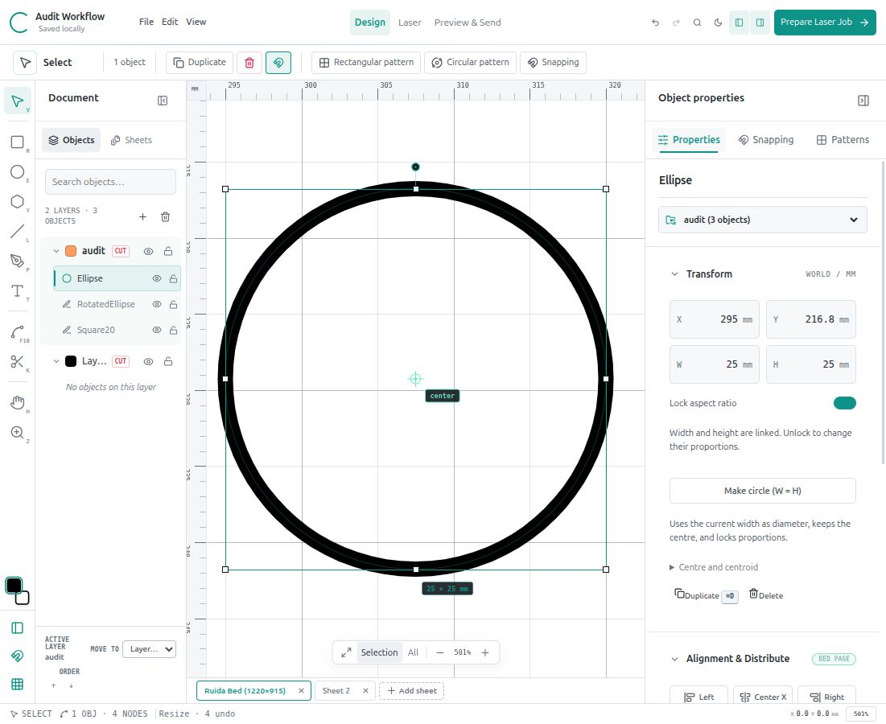

# Corelith Studio — current status

Updated 26 October 2026. This is the current entry point; dated reports retain their historical test counts and installed versions.

## Verified release

- Linux desktop release: `2026-10-26T12-36-19-596Z`.
- Served JavaScript bundle: `index-shWk_QUb.js`; desktop URL: `http://127.0.0.1:5188`.
- Verification: **109 tests passed — 99 JavaScript and 10 Python**; TypeScript/production build and whitespace checks passed. Vite still reports its large-bundle advisory.
- Source and previous installed releases are preserved. Browser and desktop profiles have separate local autosaves. Reopen/reload an existing app window after an update.

## Startup and recovery

Every launch/reload opens one blank sheet, with no artwork, selection or unfinished tool gesture. The showcase is available explicitly under **File → Restore showcase demo**.

The untouched startup document does not overwrite the previous autosave. Use **File → Restore last autosave** to recover the last local session; an absent or invalid autosave produces a message. Document changes resume autosaving and can replace that recovery copy. Save durable backups with **File → Save project** (Ctrl/Cmd+S), and reopen them with **File → Open project**. Autosave is local to the browser profile, not a project history or cloud backup.

## Latest drawing fixes

**Circle dimensions:** Transform → Make circle (W = H) turns a selected ellipse into a true circle using its current width as diameter and preserving centre/style/identity. It locks proportions so either dimension resizes the circle. For independent width/height, turn off Lock aspect ratio. Locking an oval preserves its current proportions; it does not make it circular. Untouched numeric fields no longer commit rounded display values on blur, and Escape cancels a pending numeric edit. Browser checked no-op focus/blur, 25 × 25 mm sizing and undo restoration.

**Knife:** press K. In 2-point mode, click a start and end point or drag across the artwork. With All under path disabled, select the intended editable artwork first. Small cuts work at suitable zoom; failed cuts explain why. Esc cancels. Simple closed contours need two boundary crossings; compound/multiple-crossing slicing remains unsupported and preserves the original on failure.

**Circular patterns:** the preview now displays actual outlines using the same layout as Apply. Radius 0 uses the source-to-pivot distance. Full-circle spacing reserves the original's slot only when it lies on the unshifted ring. Three new copies plus the original on that ring use 90° steps; three new copies on a different radius use 120°. Apply keeps the source selected, preventing accidental multiplication of the whole result on another Apply. A new source initializes a nearby pivot. Rotate follows the orbit angle; Upright retains the source orientation. Copies preserve source appearance; explicit layer recolouring still affects them.

Browser checks verified both Knife gestures, circular spacing/Apply and undo; temporary artwork was removed. Recovery of the original two-object Audit Workflow and subsequent blank startup were also verified.

## Laser workflow and evidence boundary

Set independent operations, speed, minimum/maximum power, passes and air assist per layer. Review Design → Laser → Preview & Send before explicit storage upload. Contour-only entry is the default; inside-first sequencing and engrave → score → cut ordering remain available. Time estimates include configured passes, leads and travel, with an optional planning allowance; acceleration and controller delays are not modelled.

Static REA/Ghidra analysis of RDWorks' supplied library confirms the existing uploader's preparation bytes, scrambling, sum16 big-endian checksum and decoded CC ACK fundamentals. No transport repair was supported by that audit. The complete RDWorks UI call sequence, exact runtime chunking and higher-level retry policy remain unverified. No cutter connection, upload, motion or firing was made during these latest fixes.

Automatic LCD refresh remains unresolved: use **Esc → File → select the uploaded filename**. No speculative refresh/select/start command was added. Curve metrics and decoded output checks do not establish physical cut equivalence to RDWorks.

Image/PDF import renders and monochrome-traces into editable vectors; native/lossless PDF vectors and grayscale/dither raster engraving remain unsupported. See the import guide for size/detail limits. Built-in preset editing, Assets, sheet duplication and grouping remain future scope.

## Documentation map

| Document | Purpose |
| --- | --- |
| [README](../README.md) | Installation, commands, drawing and laser usage |
| [Next session](../NEXT_SESSION.md) | Handoff, roadmap and historical progress |
| [App audit](APP_AUDIT.md) | Repaired faults, workflow and remaining limitations |
| [Knife/pattern/upload report](KNIFE_PATTERN_UPLOAD_FIXES.md) | Latest drawing repairs, screenshots and test coverage |
| [Native upload evidence](reverse-engineering/upload-2026-10-26/FINDINGS.md) | Recovered routines, evidence IDs and unresolved runtime questions |
| [Native curve report](RDWORKS_REVERSE_ENGINEERING.md) | Integrated arithmetic, measured geometry and evidence limits |
| [Path/scoring comparison](RDWORKS_COMPARISON.md) | Contour-only output, minimum/maximum power and native reference files |
| [Image/PDF guide](IMAGE_PDF_IMPORT.md) | Import modes, dimensions, tracing and limitations |
| [UI redesign report](ui-redesign-report.md) | Workspace redesign checkpoint and screenshots |
