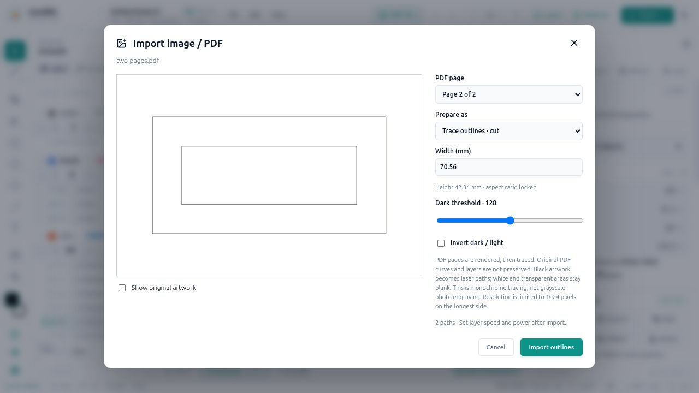

# Image and PDF imports

Updated: 26 October 2026.

Corelith imports PNG, JPEG (`.jpg` / `.jpeg`), WebP, BMP, GIF (one frame) and PDF through **File → Import vectors / image / PDF**, or the import control in the Laser inspector. Files are processed locally. The preview does not change the document until you click Import.

## Prepare an import

1. Choose the source file. For a PDF, choose the page to import. One page is imported at a time; repeat the import for additional pages.
2. Choose **Filled engraving · vector lines** or **Trace outlines · cut**.
3. Enter **Width (mm)**. Height follows the source aspect ratio. PDF page dimensions supply the initial physical size. Images initially use 96 DPI; embedded print-DPI metadata is not applied. The initial size is reduced proportionally if needed to fit the active sheet. The preview blocks import if your edited size exceeds that sheet.
4. Adjust **Dark threshold** (1–255, initially 128). A higher threshold includes lighter pixels. **Invert dark / light** reverses the source tones before thresholding; transparent background stays blank.
5. For filled engraving, set **Engraving line spacing (mm)**, initially 0.2 mm. Smaller spacing adds more lines and takes longer. The supported range is 0.05–10 mm.
6. Inspect the generated paths. **Show original artwork** switches the preview to the source image/page for comparison. Inspect holes, small details and intended dimensions before accepting.
7. Click **Import engraving** or **Import outlines**. Corelith adds a new layer and selects the imported artwork. Set speed, minimum/maximum power, passes and air assist in **Laser → Layers**, then review the complete job before export or an explicit upload.

PDF filenames include the selected page number when the source has multiple pages. Import is undoable. Imported geometry is saved as editable paths in the project; reopening the project does not require the source image/PDF. The imported source bitmap is not retained as an editable image object.

## What the two modes produce

| Mode | Generated geometry | Initial layer operation | Treatment of blank areas |
| --- | --- | --- | --- |
| Filled engraving | Horizontal vector line segments through dark regions | Engrave | Gaps and counters remain unburned; separate spans have laser-off travel |
| Trace outlines | Closed boundaries of dark regions, including internal holes and separate islands | Cut | Blank interiors remain holes; outlined regions are not automatically filled |

These are monochrome vector paths. Engraving does not encode grayscale photo power modulation, dithering or native controller raster scanning. Changing the layer operation later changes how its existing paths are processed; it does not retrace the source or regenerate the imported scan-line spacing. Reimport the source to change threshold, inversion or engraving spacing.

PDF pages are rendered with bundled PDF.js, then traced. Original PDF curves, layers, color separation and editable text are not preserved. Thin stroked lines can become outlines around both sides of the visible stroke. Pixel boundaries can appear stepped, and fine details can be lost. Use supported SVG/DXF vector geometry for dimension-critical cutting or a single cutting centerline.

## Limits and errors

| Limit | Current value |
| --- | --- |
| Source file size | 50 MiB per file |
| Source image size | 40 million pixels |
| PDF document length | 1,000 pages; one selected page per import |
| Rendered/traced bitmap | At most 1,024 pixels on the longest side |
| Generated subpaths | 10,000 per import |
| Retained nodes | 80,000 per import |
| Engraving rows | 10,000 per import |
| Trace physical dimensions | Greater than zero, at most 3,000 mm per side, and within the active sheet |

Complex outline boundaries can also hit an intermediate edge budget before simplification. No partial trace is imported when a limit is exceeded.

- **No dark artwork:** adjust threshold or inversion. A blank PDF page or fully transparent image contains nothing to trace.
- **Too complex / too many engraving rows:** use a cleaner source, reduce the import size, or increase engraving spacing. Outline and engraving modes have different complexity costs.
- **Size exceeds the sheet:** reduce width or cancel and choose the intended sheet dimensions before importing again.
- **Password-protected PDF:** unlock the PDF in a PDF editor before importing. Corelith does not prompt for a password.
- **Missing fine lines or inaccurate curved edges:** inspect the source and tracing resolution; use SVG/DXF when the original vectors are available.

## Installed app and verification

PDF.js, its worker, fonts, CMaps and WASM resources are bundled locally; import does not require a CDN. The desktop server serves worker `.mjs` files with a JavaScript MIME type. The installed release verified for this feature is `2026-10-26T09-26-44-613Z`. Reopen the desktop app after an update to load the current frontend.

Last implementation verification: **60 JavaScript + 10 Python tests passed**, and `npm run build` passed. Regression checks cover holes/islands/diagonal contacts, transparent pixels, inversion, blank/invalid inputs, complexity limits, physical aspect ratio, engraving path counts and RD readback, layer mode, undo and desktop worker MIME handling. Browser checks covered PNG engraving/outlines, both pages of a two-page PDF, import readiness and restoration of the original artwork. The production desktop server also rendered both PDF pages using its bundled worker. No cutter commands or uploads were sent during these checks.

For sending and the panel file-list behaviour, see [the app audit](APP_AUDIT.md#how-to-use-the-repaired-workflow) and [the LCD refresh investigation](RUIDA_PROTOCOL_SPECIFICATION.md#lcd-file-list-refresh--26-october-2026).
