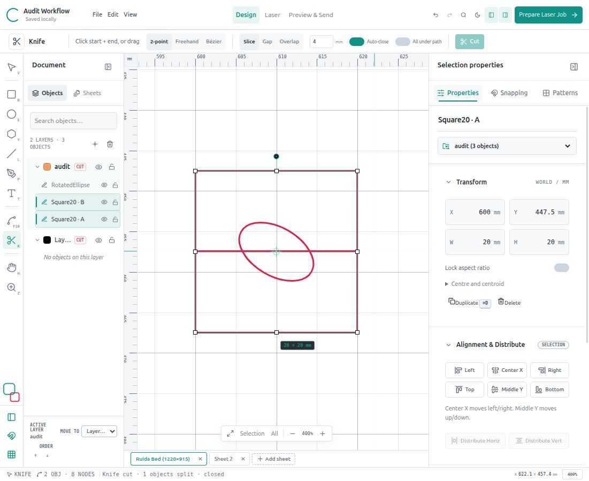
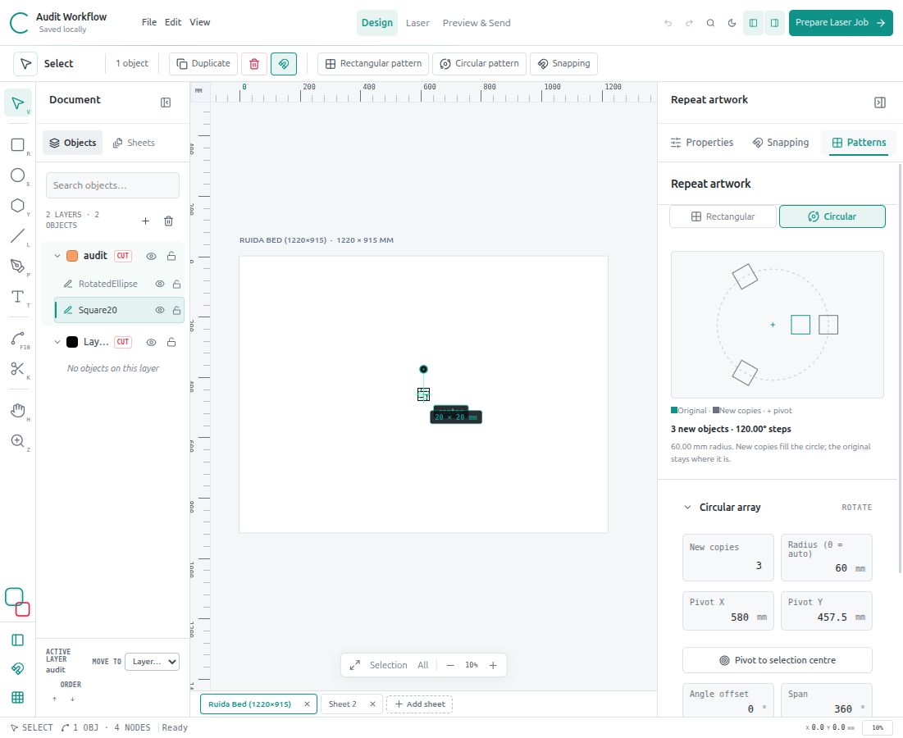

# Knife, circular patterns and RDWorks upload — 26 October 2026

## Knife repairs

The 2-point tool previously required dragging and silently cancelled a normal click–click gesture. It also rejected drags shorter than 1 mm even at high zoom. It now accepts either gesture: click the start and end, or drag across the artwork. A two-screen-pixel threshold distinguishes a click from a drag, and pointer-up supplies the final endpoint even if no move event arrives. Esc cancels. Switching modes clears an unfinished cut. Cut and Enter share the same store action; Cut is disabled until there are enough points.

Pending cuts show a rubber-band line and contextual instructions. Missing selection, unsupported contours and no-crossing results now leave an explanatory status instead of only a transient toast. With **All under path** off, select artwork first; with it on, editable artwork under the path is considered. Locked/hidden artwork remains protected.

Cubic intersections now refine the actual curve/knife crossing instead of a nearest-point approximation to a sampled chord. Short knife segments are retained. Simple closed contours require two boundary crossings; compound paths and more than two crossings remain unsupported and fail atomically. This update does not implement arbitrary compound slicing.

## Circular-pattern repairs

- A newly selected source initializes a nearby pivot rather than inheriting a stale pivot from unrelated artwork. Manual settings remain when reopening the same selection.
- A full circle reserves a position for the original only when it actually lies on that ring with zero angle offset. Otherwise the requested new copies fill the complete ring. Example: three new copies on a custom radius now use 120° steps; three new copies plus an original already on the ring use 90° steps.
- Apply keeps the source selected, so a second Apply repeats the requested number instead of multiplying the newly created group.
- The preview uses the same geometry/layout as Apply, including common multi-object bounds. It shows source outlines, copy outlines, pivot, effective radius, step angle and off-sheet warnings. Large previews explicitly show only the first 200 new objects.
- Radius 0 means automatic source-to-pivot distance. Positive spans run clockwise in canvas coordinates; negative spans run counterclockwise. Rotate turns artwork with its orbit; Upright retains its initial orientation. Pattern copies preserve the source fill and stroke rather than silently recolouring them. Explicit layer recolouring remains available.

## RDWorks transfer audit

Used the installed REA skill and Ghidra for static analysis of the original `RDWorksV8/rdcam.dll`; no vendor executable was run and no cutter connection or command was made. The DLL hash was unchanged.

Recovered library routines confirm the logical `E8 02 E7 01 <name> 00` preparation, bit swap/XOR 88/+1 scrambling, sum16 big-endian checksum and decoded CC acknowledgment polling. Corelith already matches these fundamentals. The inspected dispatcher sends once, then polls; it does not resend within that loop. Writer initialization is distinct from download preparation; DB data-end and D7 file-end are separate operations. No extra terminator or speculative refresh/select/start command was added.

This does **not** establish the complete RDWorks UI sequence, exact runtime chunk size, selected transport flags or higher-level retry behavior. A refresh-only LCD command remains unverified; use Esc → File to refresh the panel list. Static analysis cannot establish physical cut smoothness. Full evidence ledger: [native upload findings](reverse-engineering/upload-2026-10-26/FINDINGS.md). Raw REA evidence is retained in the sibling `reverse-engineering/rdworks/upload-2026-10-26` folder.

## Verification and preservation

96 JavaScript and 10 Python tests pass; production build passes (existing large-bundle advisory). Six new regressions cover click–click, pointer-up/short drags, mode cancellation, cubic intersections, full-ring spacing and repeated Apply/style/source preservation. Browser verified click–click and drag splits, custom-radius 120° preview, Apply counts/source selection and undo. Original Audit Workflow was restored to two objects, two layers and two sheets.

Pre-change backup: `backups/corelith-before-knife-pattern-fix-2026-10-26.tar.gz`. No cutter upload, selection, motion or firing was performed.

Historical installed checkpoint for these fixes: `2026-10-26T12-19-04-552Z`. Idle old backend was restarted after checking local busy=false; launcher readiness and exact served bundle `index-NXIIgWKZ.js` were verified on port 5188. Reopen or reload an already-open desktop window to load it. Previous releases and browser projects are preserved.

## Subsequent clean-startup update

The latest release is `2026-10-26T12-25-11-263Z` (`index-DyyC2It9.js`). It retains the fixes above and starts on one empty sheet. Use **File → Restore last autosave** to reopen prior work. Startup itself does not overwrite that autosave; document changes resume autosaving. The current verified suite is **97 JavaScript + 10 Python tests**, plus a successful production build. See [current status](CURRENT_STATUS.md).
