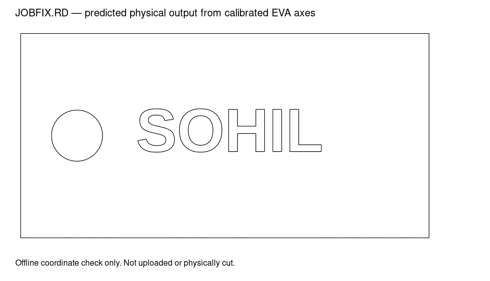

# SOHIL output orientation — 26 October 2026

## Evidence and correction

The operator supplied a photo of vertically reflected SOHIL, confirmed the LCD showed the same result, and identified `JOB.RD`. Read-only FTP retrieved `/driver/workfile/JOB.RD ` from the EVA controller. The 5,880-byte fixture and SHA-256 are recorded in `tests/fixtures/controller/2026-10-26-text/readback.json`.

The job contains an 80 × 40 mm rectangle, a 10 mm circle and six closed text contours. Viewed as Y-down coordinates, the raw RD has horizontally reflected text. Reflecting both raw coordinate axes reproduces the supplied photo, including the circle on the left and the L bar at the top. This establishes the output-coordinate mapping for this observed job: both axes reverse relative to the canvas, represented by **bottom-right** in Corelith.

The earlier top-right profile assumption was wrong. `Origin=2` in a local RDWorks configuration was insufficient evidence for that conclusion. This calibration describes observed output axes; it does not establish the machine’s mechanical homing corner. The earlier screenshot `text-orientation-fixed.png` is superseded and must not guide settings.

## Implementation and use

- Default EVA output orientation is bottom-right. The canvas origin marker uses the same fallback.
- The control is labelled **Controller output orientation**. Existing EVA documents with a different orientation are blocked during UI RD preparation, with **Use corrected EVA orientation** as an undoable repair.
- **Restore saved EVA defaults** restores the calibrated orientation as well as the destination.
- Font conversion remains unchanged. A global text flip would also damage correct imported outlines and other machine profiles.
- Regenerate and explicitly replace previously uploaded files; existing controller files retain their original coordinates. This investigation did not upload or select a replacement.

## Recovered job

`corrected/JOBFIX.RD` is an offline corrected replacement. `corrected/SOHIL-recovered.corelith.json` contains reconstructed polylines, not the original editable text or curves. Kerf and leads are disabled to avoid reapplying machining compensation to captured paths. All eight contours and 1,010 unique vertices match the intended upright reconstruction after applying the calibrated controller axes.

Encoded settings are preserved: text 400 mm/s, approximately 12% minimum and maximum power; circle/frame 30 mm/s, approximately 50% minimum and maximum power; air assist enabled for both. Quantized values and input/output hashes are in [the readback report](sohil-job-readback.json). These are the values in this particular file, not inferred from earlier scoring discussions.

[Raw and reflected coordinate comparison](sohil-controller-orientations.png).

## Verification and limits

**102 JavaScript + 10 Python tests passed**, production build passed. Regression coverage includes this exact JOB.RD fixture, asymmetric F2R outlines and hatch paths, mismatch directions, repair/undo preserving artwork and layer settings, and unrelated destinations. The actual-job check demonstrates the old inverted L and validates corrected exported geometry against every source vertex.

These are decoded-command checks calibrated against the existing physical photo. The corrected file has not been uploaded or physically cut. No machine parameters, selection, motion or firing were changed.

Installed release: `2026-10-26T13-12-14-749Z`, bundle `index-BCPKd7zt.js`. Source and previous releases are preserved. Reload/reopen the app to load the update.
